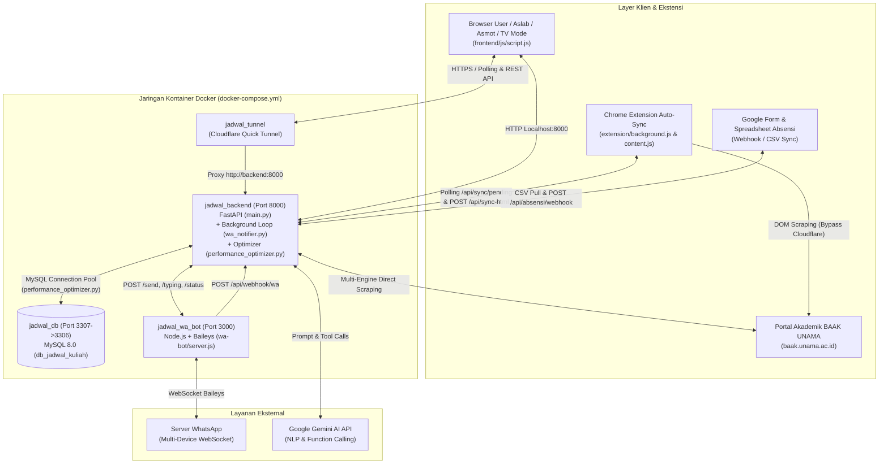
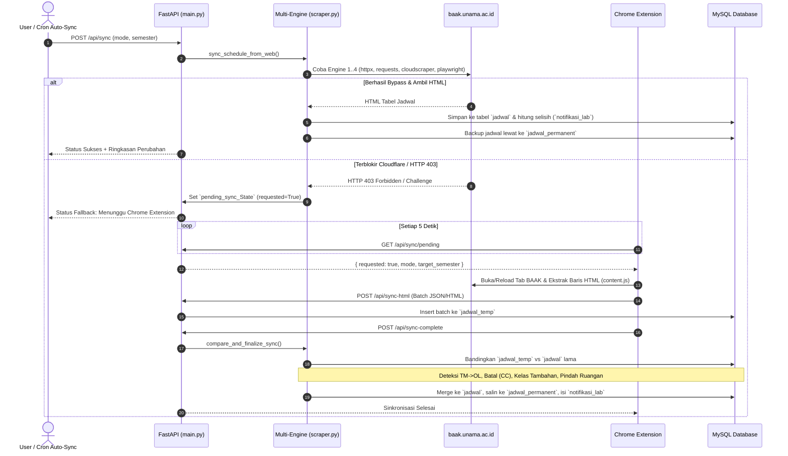
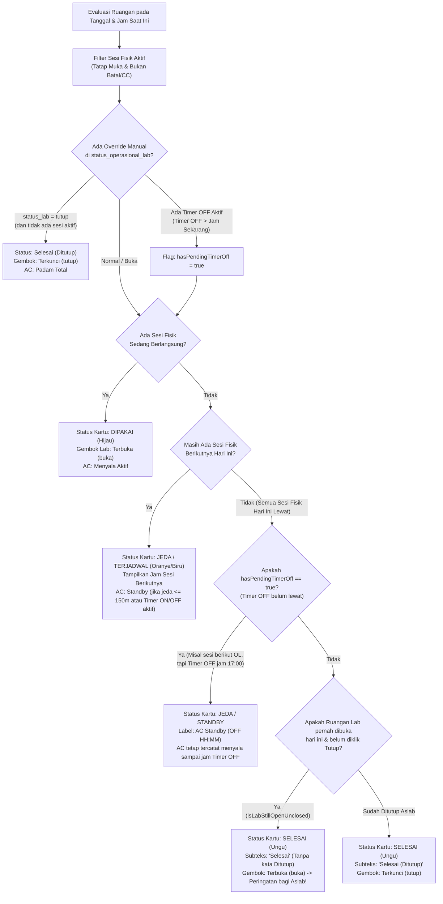

# Dokumentasi Arsitektur, Struktur, dan Alur Sistem Jadwal Kuliah & Operasional Lab UNAMA

Dokumen ini memuat pemetaan menyeluruh terhadap arsitektur kontainer, struktur kode, skema database MySQL, serta alur kerja (*end-to-end data flow*) dari seluruh subsistem pada aplikasi **Jadwal Kuliah & Operasional Laboratorium/Ruangan UNAMA**.

---

## 1. Gambaran Umum & Topologi Arsitektur Sistem

Sistem berjalan sebagai ekosistem terdistribusi berbasis kontainer Docker (`docker-compose.yml`) yang dipadukan dengan ekstensi peramban (**Chrome Extension Manifest V3**) untuk melintasi proteksi Cloudflare/WAF pada portal akademik BAAK UNAMA.



### Daftar Layanan Kontainer (`docker-compose.yml`)

| Nama Kontainer | Service | Teknologi | Port Host:Container | Peran Utama |
| :--- | :--- | :--- | :--- | :--- |
| `jadwal_db` | `db` | MySQL 8.0 | `3307:3306` | Penyimpanan relasional utama (`db_jadwal_kuliah`) dengan volume persisten `db_data`. |
| `jadwal_backend` | `backend` | Python FastAPI + Uvicorn | `8000:8000` | Server API utama (`main.py`), kompilator template HTML (`scripts/build_html.py`), mesin scraping (`backend/scraper.py`), pengoptimasi performa (`backend/performance_optimizer.py`), dan *background daemon* pengingat WhatsApp (`backend/wa_notifier.py`). |
| `jadwal_wa_bot` | `wa-bot` | Node.js + `@whiskeysockets/baileys` | `3000:3000` | Gateway WhatsApp Multi-Device (`wa-bot/server.js`) untuk mengirim notifikasi ke grup/personal dan meneruskan pesan masuk ke webhook backend. |
| `jadwal_tunnel` | `tunnel` | `cloudflare/cloudflared` | Internal (`backend:8000`) | Membuka akses publik HTTPS (`*.trycloudflare.com`) dan mencatat URL tunnel aktif ke `tunnel_logs/tunnel.log`. |

---

## 2. Peta Struktur Direktori Proyek

```text
jadwal-kuliah-unama/
├── main.py                          # Entrypoint FastAPI, autentikasi HMAC, >75 endpoint REST API, static server
├── docker-compose.yml               # Orkestrasi 4 kontainer (db, wa-bot, backend, tunnel)
├── Dockerfile                       # Image Python backend + dependensi sistem
├── requirements.txt                 # Dependensi Python (fastapi, mysql-connector-python, beautifulsoup4, dll.)
├── index.html                       # File HTML hasil kompilasi otomatis dari frontend/templates/
├── backend/
│   ├── scraper.py                   # Multi-engine scraper, manajemen skema DB, deteksi perubahan jadwal & jeda
│   ├── wa_notifier.py               # Daemon background loop pengingat WA, Info Mase, AI Chatbot Gemini
│   └── performance_optimizer.py     # Connection pooling MySQL, in-memory TTL cache, auto-indexing DB
├── frontend/
│   ├── css/style.css                # Styling utama dashboard, kartu lab/ruangan, dark mode, TV mode
│   ├── js/script.js                 # Engine state frontend, evaluasi status lab/AC, timer remote, spotlight
│   └── templates/
│       ├── index.html               # Kerangka utama HTML dengan direktif <!-- INCLUDE: ... -->
│       └── components/              # Komponen modular HTML (header, navbar, modals, tv_view, settings, dll.)
├── wa-bot/
│   ├── server.js                    # Express API + Baileys WhatsApp socket (Port 3000)
│   └── auth_info_baileys/           # Sesi kredensial login WhatsApp Multi-Device
├── extension/
│   ├── manifest.json                # Konfigurasi Chrome Extension Manifest V3
│   ├── background.js                # Service worker polling antrean sinkronisasi (/api/sync/pending)
│   ├── content.js                   # Injeksi skrip ekstraksi tabel HTML di portal baak.unama.ac.id
│   └── popup.html / popup.js        # Antarmuka kontrol manual ekstensi
├── scripts/
│   └── build_html.py                # Kompilator modular frontend/templates/index.html -> index.html
└── docs/
    ├── ARSITEKTUR_DAN_ALUR_SISTEM.md # Dokumentasi arsitektur & alur kerja seluruh sistem
    └── PLAN_OPTIMASI_PERFORMA.md     # Analisis bottleneck & rencana optimasi performa sistem
```

---

## 3. Skema Database Relasional (`db_jadwal_kuliah`)

Skema database diinisialisasi secara otomatis dan idempoten melalui fungsi `init_db_schema()` di `backend/scraper.py` serta diperkuat dengan indeks komposit oleh `ensure_performance_indexes()` di `backend/performance_optimizer.py`.

```mermaid
erDiagram
    SEMESTER ||--o{ JADWAL : "memiliki"
    RUANGAN ||--o{ JADWAL : "menempati"
    RUANGAN ||--o{ STATUS_OPERASIONAL_LAB : "memiliki_status"
    SEMESTER ||--o{ JADWAL_PERMANENT : "menyimpan_arsip"
    RUANGAN ||--o{ JADWAL_PERMANENT : "menempati"
    SEMESTER ||--o{ NOTIFIKASI_LAB : "mencatat_perubahan"

    SEMESTER {
        varchar id_semester PK
        varchar nama_semester
        tinyint is_active
        timestamp updated_at
    }

    RUANGAN {
        int id_ruangan PK
        varchar nama_ruangan UK
        varchar kategori "lab | umum | lainnya"
        varchar kampus "Thehok | Kobar | Sipin"
    }

    JADWAL {
        int id PK
        varchar semester FK
        varchar hari
        varchar tanggal "DD-MM-YYYY"
        varchar jam "HH:MM-HH:MM"
        varchar kelas
        varchar kode_mk
        varchar mata_kuliah
        varchar dosen
        int id_ruangan FK
        varchar status "Terjadwal | Selesai | Batal"
        varchar metode "Tatap Muka | Online |Kosong"
        varchar tipe_kelas "reguler | tambahan"
        varchar status_lab "kosong | belum_buka | buka | tutup"
        varchar timer_ac_on "HH:MM"
        varchar timer_ac_off "HH:MM"
    }

    JADWAL_TEMP {
        int id PK
        varchar semester
        varchar tanggal
        varchar jam
        varchar kelas
        varchar kode_mk
        varchar ruangan
        varchar status
        varchar metode
    }

    JADWAL_PERMANENT {
        int id PK
        varchar semester
        varchar tanggal
        varchar jam
        varchar kelas
        varchar kode_mk
        int id_ruangan
        varchar status
        varchar metode
        varchar tipe_kelas
    }

    STATUS_OPERASIONAL_LAB {
        int id PK
        varchar tanggal "DD-MM-YYYY"
        int id_ruangan FK
        varchar jam "HH:MM-HH:MM"
        varchar status_lab "belum_buka | buka | tutup"
        varchar timer_ac_on "HH:MM"
        varchar timer_ac_off "HH:MM"
        timestamp updated_at
    }

    NOTIFIKASI_LAB {
        int id PK
        varchar tanggal "DD-MM-YYYY"
        varchar semester FK
        varchar ruangan
        varchar jam_awal
        varchar jam_akhir
        int durasi_menit
        varchar tipe_notif "jeda | pindah_online | batal | tambahan | pindah_ruangan"
        varchar pesan
        tinyint is_sent
    }

    ASISTEN_LAB {
        int id PK
        varchar nama
        varchar nim
        varchar no_wa
        varchar kampus "Thehok | Kobar | Semua"
        varchar role "Aslab | Asmot"
        tinyint is_active
        varchar labs_assigned
    }

    ABSENSI_ASLAB {
        int id PK
        varchar response_hash UK
        varchar timestamp_str
        varchar tanggal "DD-MM-YYYY"
        varchar nama_aslab
        varchar jenis_kegiatan "Buka Labor | Tutup Labor"
        varchar nomor_lab
        varchar matkul
        varchar dosen
    }
```



### Tabel Pendukung Lainnya:
- **`dosen`** (`id_dosen`, `nama_dosen`) & **`mata_kuliah`** (`kode_mk`, `nama_mk`, `sks`): Master data dosen dan mata kuliah.
- **`kurikulum_mata_kuliah`** & **`kurikulum_perubahan`**: Menyimpan struktur kurikulum per program studi (TI, SI, SK) dan riwayat perubahannya.
- **`absensi_master_aslab`** & **`absensi_master_lab`**: Daftar master nama asisten dan nomor lab untuk pencocokan otomatis laporan absensi Google Form.
- **`log_scraping_engine`**: Mencatat performa, durasi (ms), dan status sukses/gagal dari setiap engine scraping (`Async-httpx`, `Fast-Requests`, `Cloudscraper`, `Browser-Playwright`, `Chrome-Extension`).
- **`log_sent_notifications`**: Kunci idempotensi (`notif_key`) agar notifikasi WhatsApp tidak pernah terkirim ganda meskipun container di-restart.
- **`server_link_config`** & **`server_link_history`**: Konfigurasi penerima dan riwayat URL publik Cloudflare Tunnel.

---

## 4. Alur Kerja Utama Sistem (*System Workflows*)

### 4.1. Alur Sinkronisasi & Scraping Hybrid BAAK (`scraper.py` + `extension/` + `main.py`)

Sistem menggunakan pendekatan **Hybrid Multi-Engine + Browser Extension Fallback**:



1. **Deteksi Perubahan Otomatis (`compare_and_finalize_sync`)**:
   - Membandingkan snapshot jadwal sebelum sinkronisasi (`old_map`) dengan data baru (`jadwal_temp`).
   - Mencatat setiap perubahan ke tabel `notifikasi_lab` dengan tipe:
     - `pindah_online`: Sebelumnya **Tatap Muka (TM)** berubah menjadi **Online (OL)** -> ruangan fisik menjadi kosong.
     - `batal`: Status berubah menjadi **Batal (CC)** -> ruangan fisik menjadi kosong.
     - `tambahan`: Muncul sesi kuliah baru atau perubahan dari Online ke Tatap Muka -> ruangan fisik digunakan.
     - `pindah_ruangan`: Sesi kuliah berpindah dari satu ruangan ke ruangan lain.
     - `jeda`: Terdapat jeda waktu kosong antar sesi tatap muka di ruangan yang sama ($\ge 30$ menit dan $< 180$ menit).
2. **Proteksi Data Historis (`jadwal_permanent`)**:
   - Karena portal BAAK hanya menampilkan jadwal minggu berjalan, setiap jadwal yang sudah lewat disimpan ke `jadwal_permanent`. Saat endpoint `GET /api/jadwal` dipanggil, sistem melakukan `UNION` antara jadwal aktif di `jadwal` dan riwayat di `jadwal_permanent` tanpa duplikasi.

---

### 4.2. Alur Evaluasi Status Kartu Lab, Gembok, dan Smart AC Engine (`frontend/js/script.js`)

Setiap kartu ruangan di panel **"Labor yang lagi dipakai"** (fokus kunci/gembok untuk Aslab) dan **"Ruang yang lagi dipakai"** (fokus AC & Timer untuk Asmot) dievaluasi secara real-time oleh tiga fungsi inti di [`frontend/js/script.js`](file:///d:/Kuliah/Projek/jadwal/jadwal-kuliah-unama/frontend/js/script.js):
1. [`evaluateRoomCardStatus()`](file:///d:/Kuliah/Projek/jadwal/jadwal-kuliah-unama/frontend/js/script.js#L5400-L5618)
2. [`calculateRoomAcStatus()`](file:///d:/Kuliah/Projek/jadwal/jadwal-kuliah-unama/frontend/js/script.js#L6296-L6540)
3. [`getRoomOperationalStatus()`](file:///d:/Kuliah/Projek/jadwal/jadwal-kuliah-unama/frontend/js/script.js#L5625-L5806)



#### Fitur Penting Smart AC & Timer Remote:
1. **3 Format Remote AC Fisik (`openTimerModal`)**:
   - **Model 24 Jam (`24h`)**: Menyimpan jam presisi `HH:MM` (contoh: `09:15`, `17:00`).
   - **Model 12 Jam AM/PM (`12h`)**: Mengikuti perilaku remote AC fisik di kampus yang memiliki kenaikan setiap **30 menit** (`09:00 AM`, `09:30 AM`, dst.). Saat disetel manual di UI, waktu yang dipilih pengguna dipertahankan secara presisi tanpa ditimpa oleh waktu sesi kuliah.
   - **Model Durasi Per Jam (`duration`)**: Menghitung jam target dari waktu sekarang ditambah $N$ jam (pembulatan 1 jam remote fisik).
2. **Eksekusi Otomatis Saat Waktu Timer Tercapai (`checkAndTriggerAcTimers`)**:
   - Berjalan setiap 15 detik di frontend.
   - Saat waktu sekarang melewati `timer_ac_on`, status ruangan otomatis berubah menjadi `buka` (AC Menyala) dan `timer_ac_on` dibersihkan.
   - Saat waktu sekarang melewati `timer_ac_off`:
     - Untuk **Ruang Kelas Umum (`R. x.x`)**: Otomatis mengubah `status_lab = 'tutup'` (AC Padam) dan membersihkan `timer_ac_off`.
     - Untuk **Ruang Laboratorium (`Lab x.x`)**: Hanya mematikan indikator Timer AC tanpa mengunci gembok pintu lab secara sepihak, sehingga gembok lab tetap merepresentasikan apakah Aslab benar-benar sudah mengunci pintu atau belum.
3. **Pergantian Hari Otomatis Tengah Malam (`checkMidnightDateRollover`)**:
   - Tepat pukul `00:00 WIB`, dashboard otomatis memindahkan filter tanggal ke hari baru, mereset cache lokal `status_operasional_lab` hari sebelumnya, dan memuat jadwal hari baru.

---

### 4.3. Alur Background WA Notifier, Info Mase, & AI Chatbot (`backend/wa_notifier.py` & `wa-bot/server.js`)

Daemon [`wa_notifier_loop()`](file:///d:/Kuliah/Projek/jadwal/jadwal-kuliah-unama/backend/wa_notifier.py#L4830-L5007) berjalan di background thread FastAPI setiap **30 detik**:

```mermaid
sequenceDiagram
    autonumber
    participant Loop as wa_notifier_loop (30s)
    participant DB as MySQL Database
    participant Gemini as Google Gemini AI
    participant WABot as wa-bot (Port 3000)
    participant Group as Grup WA / Aslab / Asmot

    loop Setiap 30 Detik
        Loop->>DB: Cek perubahan URL Cloudflare Tunnel
        opt URL Tunnel Berubah
            Loop->>WABot: Kirim URL Baru ke Nomor Terdaftar
        end

        Loop->>DB: Evaluasi Jadwal Hari Ini (WIB)
        opt H-20 / H-15 Sesi Pertama atau Terakhir
            Loop->>WABot: Kirim Pengingat Buka/Tutup Lab (Aslab)
            Loop->>WABot: Kirim Batching Instruksi Nyalakan/Matikan AC (Asmot)
            Loop->>DB: Catat notif_key ke `log_sent_notifications`
        end

        Loop->>DB: Cek antrean `notifikasi_lab` (is_sent = 0)
        opt Ada Perubahan (Batal CC / TM jadi OL / Kelas Tambahan)
            Loop->>WABot: Kirim "INFO MASE - OPERASIONAL KELAS"\n(Dikelompokkan dengan garis pemisah per kategori)
            Loop->>DB: Update is_sent = 1 pada `notifikasi_lab`
        end
    end

    Note over Group,WABot: Interaksi Chatbot Dua Arah
    Group->>WABot: Pesan WA ("@bot info lab kobar", "jadwal pak setiawan")
    WABot->>Loop: POST /api/webhook/wa
    Loop->>Gemini: Evaluasi Intent & Function Calling (Query DB)
    alt Gemini API Aktif
        Gemini-->>Loop: Jawaban Natural Berbasis Data Real-Time DB
    else Gemini Limit / Offline
        Loop->>Loop: Fallback Regex Engine Lokal
    end
    Loop->>WABot: POST /send (Balasan ke Pengirim/Grup)
```

#### Format Siaran "INFO MASE - OPERASIONAL KELAS":
Pesan perubahan mendadak dikelompokkan berdasarkan urgensi operasional agar mudah dibaca oleh petugas:
1. Kelompok **BATAL (CC)** (Ruangan menjadi kosong).
2. Pemisah visual (`┈┈┈┈┈┈┈┈┈┈┈┈┈┈┈┈┈┈┈┈`).
3. Kelompok **TM jadi OL** (Ruangan menjadi kosong).
4. Pemisah visual (`┈┈┈┈┈┈┈┈┈┈┈┈┈┈┈┈┈┈┈┈`).
5. Kelompok **KELAS TAMBAHAN / PINDAH RUANGAN** (Ruangan fisik digunakan).

---

### 4.4. Alur Kompilasi Template & Mode Tampilan Frontend

1. **Sistem Template Modular (`scripts/build_html.py`)**:
   - File sumber utama berada di [`frontend/templates/index.html`](file:///d:/Kuliah/Projek/jadwal/jadwal-kuliah-unama/frontend/templates/index.html) yang memanggil komponen-komponen di `frontend/templates/components/*.html` menggunakan sintaks `<!-- INCLUDE: components/nama_file.html -->`.
   - Skrip [`scripts/build_html.py`](file:///d:/Kuliah/Projek/jadwal/jadwal-kuliah-unama/scripts/build_html.py) menggabungkan seluruh komponen menjadi satu file produksi [`index.html`](file:///d:/Kuliah/Projek/jadwal/jadwal-kuliah-unama/index.html) di root proyek.
2. **5 Mode Eksplorasi & Monitoring**:
   - **Live Dashboard**: Monitoring status lab & ruang kelas real-time, filter multi-dimensi (Tanggal, Sesi Waktu, Status Kuliah, Kampus, Kategori, Ruangan), dan tabel jadwal interaktif.
   - **Semester Explorer**: Eksplorasi seluruh jadwal 1 semester penuh per program studi, angkatan, kelas, atau dosen.
   - **Statistik & Analitik**: Visualisasi tingkat okupansi ruangan, distribusi metode kuliah (TM vs OL), dan beban SKS dosen.
   - **Kurikulum Explorer**: Perbandingan mata kuliah antar kurikulum (2015, 2020, 2024, 2025) beserta pelacakan mata kuliah yang berubah/dihapus.
   - **TV / Kiosk Mode**: Tampilan layar penuh otomatis (*auto-scroll* & *auto-rotate* halaman) untuk layar monitor informasi di lobi/ruang aslab.

---

## 5. Keamanan & Autentikasi API

- **HMAC-SHA256 Token (`verify_token`)**:
  - Seluruh endpoint sensitif (pengaturan sistem, manajemen asisten, eksekusi sinkronisasi manual, backup/restore SQL, konfigurasi WA) dilindungi oleh token bertanda tangan `HMAC-SHA256` dengan masa berlaku (*expiration*) 24 jam.
- **Kredensial Terenkripsi Lingkungan (`.env`)**:
  - Password admin (`ADMIN_PASSWORD`), kunci rahasia token (`AUTH_SECRET_KEY`), kredensial database, dan `GEMINI_API_KEY` dimuat dari variabel lingkungan.
