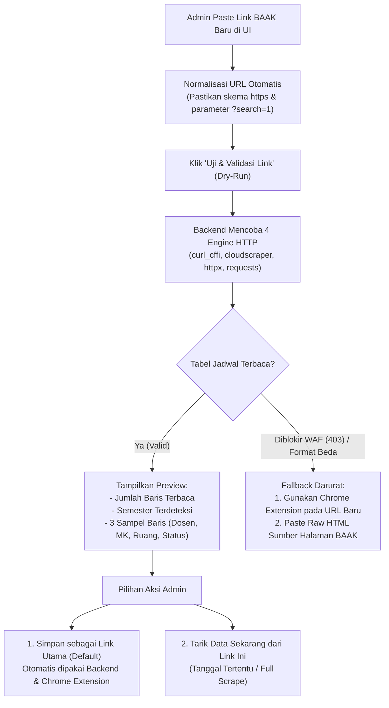

# Master Plan: Kemandirian Sistem (>= 92% Autopilot), Dynamic Scraper Link Manager, dan Arsitektur True Admin

Dokumen ini memuat rancangan arsitektur dan rencana implementasi menyeluruh untuk meningkatkan tingkat kemandirian sistem **Jadwal Kuliah & Operasional Lab UNAMA** dari **~85% menjadi >= 92% (Set-and-Forget / Autopilot)**, lengkap dengan fitur **Dynamic Scraper Link Paste** (tanpa perlu ubah kode saat BAAK ganti URL) serta rancangan **True Admin Login & Control Center**.

---

## 1. Peta Peningkatan Kemandirian Sistem (Target >= 92%)

| Area Sistem | Kondisi Saat Ini | Target Pembaruan | Dampak Kemandirian |
| :--- | :--- | :--- | :--- |
| **Sumber Link Scraper BAAK** | URL hardcoded di [`backend/scraper.py`](file:///d:/Kuliah/Projek/jadwal/jadwal-kuliah-unama/backend/scraper.py) dan [`main.py`](file:///d:/Kuliah/Projek/jadwal/jadwal-kuliah-unama/main.py) | **Dynamic URL Manager + Paste Link / Raw HTML di UI** (tersimpan di DB) | Saat BAAK ganti URL lagi, cukup paste link baru di UI tanpa menyentuh kode |
| **Sistem Login & Hak Akses Admin** | Toggle sederhana `Admin: ON/OFF` via `.env`, belum semua endpoint terkunci, belum ada manajemen akun/audit | **True Admin Login, Role-Based Access, Proteksi Penuh Endpoint, & Admin Control Center** | Kontrol jelas antara Publik, Aslab/Asmot, Koordinator, dan Super Admin |
| **Koreksi Jadwal Mendadak** | Hanya mengandalkan hasil scrape BAAK; belum ada form edit/kunci jadwal manual di UI | **CRUD Jadwal Manual + Lock Override** agar tidak tertimpa sinkronisasi otomatis | Admin bisa langsung mengoreksi jadwal/dosen/status tanpa tunggu BAAK |
| **Koneksi WhatsApp Bot** | Jika sesi `loggedOut`, harus buka terminal server untuk scan QR ulang | **Preview Status & Scan QR WhatsApp langsung di Dashboard Admin** | Pemulihan sesi WA bisa dilakukan mandiri dari browser |
| **Backup Database & Log** | Backup `.sql` masih manual dari tombol UI; file log belum dirotasi otomatis | **Auto-Backup Harian (Retensi 7 Hari) + Auto-Prune Log Lama** | Database aman dari kehilangan data dan disk server tidak pernah penuh |
| **Pergantian Semester** | Deteksi semester otomatis ada, tetapi aktivasi semester utama masih manual/terbuka | **Auto-Detect & One-Click / Auto-Rollover Semester khusus Admin** | Transisi semester Ganjil/Genap berjalan mulus tanpa intervensi kode |

---

## 2. Rancangan Fitur: Dynamic Scraper Link Manager ("Tempat Paste Link Scraper")

### 2.1. Tujuan
Jika suatu saat pihak BAAK UNAMA kembali mengubah alamat halaman jadwal (misalnya dari `https://baak.unama.ac.id/jadwal-kuliah1` menjadi `/jadwal-kuliah2`, `/jadwal-perkuliahan`, atau domain baru) selama struktur informasi di dalam tabel masih serupa (Tanggal, Dosen-Matakuliah, Ruang, Status), Admin **tidak perlu mengedit kode Python/JS atau restart container**. Admin cukup menempelkan (*paste*) link baru tersebut di antarmuka web.

### 2.2. Alur Kerja (Workflow) Paste Link Scraper



### 2.3. Penyimpanan Konfigurasi di Database (`konfigurasi_sistem`)
Menambahkan tabel ringan `konfigurasi_sistem` di [`backend/scraper.py`](file:///d:/Kuliah/Projek/jadwal/jadwal-kuliah-unama/backend/scraper.py):

```sql
CREATE TABLE IF NOT EXISTS konfigurasi_sistem (
    kunci VARCHAR(100) PRIMARY KEY,
    nilai TEXT NOT NULL,
    keterangan VARCHAR(255) NULL,
    updated_at TIMESTAMP DEFAULT CURRENT_TIMESTAMP ON UPDATE CURRENT_TIMESTAMP
) ENGINE=InnoDB DEFAULT CHARSET=utf8mb4;
```

Daftar kunci konfigurasi scraper yang disimpan:
- `scraper_primary_url`: URL utama aktif (default: `https://baak.unama.ac.id/jadwal-kuliah1?search=1`).
- `scraper_fallback_urls`: Daftar URL cadangan dipisahkan koma (misal `https://baak.unama.ac.id/jadwal-kuliah?search=1`).
- `scraper_auto_midnight`: Status aktif/nonaktif full scrape jam 12 malam (`1` / `0`).
- `scraper_sync_interval_min`: Interval auto-sync siang hari dalam menit (default: `15`).
- `scraper_max_pages_full`: Batas halaman saat full scrape (default: `300`).

### 2.4. Fitur Panel "Sumber & Link Scraper BAAK" di UI
Ditempatkan pada modal [`frontend/components/modal-scraper-logs.html`](file:///d:/Kuliah/Projek/jadwal/jadwal-kuliah-unama/frontend/components/modal-scraper-logs.html) dan **Admin Control Center**:
1. **Kotak Input Paste Link Target**:
   - Menerima link apa saja yang di-copy dari address bar browser saat membuka BAAK (contoh: `https://baak.unama.ac.id/jadwal-kuliah-baru?search=1&tanggal=2026-11-18&page=3`).
   - Sistem otomatis membersihkan parameter `page=` dan `tanggal=` saat disimpan sebagai Base URL, serta memastikan parameter `search=1` terpasang.
2. **Tombol "Uji & Preview Link" (`POST /api/admin/scraper/validate-url`)**:
   - Mengetes koneksi ke URL tersebut dan menjalankan `parse_html_content()` secara *dry-run* (tanpa mengubah database dulu).
   - Menampilkan kartu hasil uji: Status HTTP, Engine tercepat yang tembus, Semester yang terdeteksi, Jumlah baris jadwal yang ditemukan di halaman 1, serta sampel 3 jadwal pertama (Nama Dosen, Kelas, Mata Kuliah, Ruangan, Status).
3. **Tombol "Simpan sebagai Link Utama" (`POST /api/admin/scraper/config`)**:
   - Menyimpan URL baru ke `konfigurasi_sistem`.
   - Seluruh proses `scrape_baak_direct()`, `test_all_scraping_engines()`, serta URL fallback untuk **Chrome Extension** (`extension/background.js`) otomatis menggunakan URL baru ini.
4. **Tombol "Scrape Sekarang dari Link Ini" (`POST /api/admin/scraper/run-custom`)**:
   - Menjalankan penarikan data seketika menggunakan URL yang di-paste (bisa pilih mode: *Hanya Tanggal Aktif* atau *Full Scrape Semua Halaman*).
5. **Tab Darurat: "Paste Raw HTML / Upload File HTML" (`POST /api/admin/scraper/parse-raw-html`)**:
   - Jika suatu ketika IP server diblokir penuh oleh firewall BAAK, Admin cukup membuka halaman BAAK dari perangkat mana pun, klik kanan *View Page Source* (atau simpan seperti file `.md`), lalu paste isinya ke kotak teks ini untuk langsung diproses ke database.

---

## 3. Rancangan Lengkap: "True Admin Login" & Hak Akses Admin

### 3.1. Perbedaan Jelas Antara Pengguna Biasa vs Admin

| Aspek | Pengguna Publik / Mahasiswa / Dosen | Aslab & Asmot (Mode Operasional) | Admin Terautentikasi (True Admin) |
| :--- | :--- | :--- | :--- |
| **Cara Masuk** | Langsung buka web dashboard | Buka web dashboard / terdaftar di WA Bot | Login via **Modal Login Admin** (Username/Password + Sesi Token Terenkripsi) |
| **Data Nomor WA Aslab** | Disamarkan (*masked*: `0812****1180`) | Disamarkan di web publik | **Tampil penuh** beserta `wa_lid` dan kontrol edit/hapus |
| **Operasional Ruangan** | Hanya lihat status & jadwal | Buka/Tutup Lab, Set Timer AC, Isi Absensi Dosen | **Full Override**: paksa buka/tutup semua lab, edit/hapus absensi, kelola master lab |
| **Jadwal Kuliah** | Lihat, filter, cari dosen/kelas | Lihat jadwal & terima notifikasi WA | **CRUD Jadwal Manual**, kunci jadwal (*Lock Override*), hapus/restore jadwal |
| **Konfigurasi Scraper** | Hanya bisa klik Sync standar | Hanya bisa klik Sync standar & lihat log | **Paste/ganti URL Scraper**, trigger Full Scrape paksa, paste Raw HTML, hapus log |
| **Database & Sistem** | Tidak terlihat (tersembunyi penuh) | Tidak terlihat (tersembunyi penuh) | **Backup/Restore SQL, Clear DB, Ganti Semester Aktif, Scan QR WA Bot, Audit Log** |

### 3.2. Sistem Autentikasi & Keamanan Login Admin

1. **Tabel Akun Admin (`admin_users`) & Audit Trail (`log_audit_admin`)**:
   - Menyimpan akun admin di database dengan password yang di-hash (`PBKDF2-HMAC-SHA256` / `bcrypt`), dilengkapi dukungan multi-role:
     - **`SUPER_ADMIN`**: Memiliki seluruh hak akses sistem termasuk manajemen akun admin, pembersihan database (*Clear DB*), restore database, dan pengaturan tingkat server.
     - **`KOORDINATOR`**: Memiliki hak kelola operasional harian (kelola jadwal, kelola aslab/asmot/ruangan, kelola absensi, dan update link scraper), namun tidak bisa menghapus database utama.
   - Saat pertama kali dijalankan (migrasi awal), sistem otomatis membuat akun `SUPER_ADMIN` default dari variabel `.env` (`ADMIN_PASSWORD` & `MASTER_PASSWORD`) agar kompatibel penuh dengan konfigurasi lama.
2. **Alur Login & Manajemen Sesi**:
   - **Langkah 1 (Login Standar)**: Input Username (default: `admin`) & Password Admin pada modal login yang bersih, menampilkan indikator role dan masa aktif sesi (12 jam, dapat diperpanjang atau *Logout* kapan saja).
   - **Langkah 2 (Step-Up Master PIN / Password Master)**: Khusus untuk tindakan destruktif berisiko tinggi (seperti *Clear Database*, *Restore Database*, atau *Hapus Semester*), sistem meminta verifikasi lapis kedua berupa **Master Password + Kode Unik**.
   - **Proteksi Brute-Force**: Maksimal 5 percobaan gagal per IP dalam 5 menit (otomatis terkunci sementara selama 5 menit dan tercatat di `log_audit_admin`).
   - **Penutupan Celah Endpoint API di [`main.py`](file:///d:/Kuliah/Projek/jadwal/jadwal-kuliah-unama/main.py)**:
     Mengunci seluruh endpoint mutasi/sensitif yang sebelumnya belum memakai `Depends(verify_admin_token)`:
     - `POST /api/semesters/active` (mengubah semester aktif sistem)
     - `GET /api/admin/chatbot-logs` (membaca log internal chatbot WA)
     - `DELETE /api/absensi/{id_absensi}` (menghapus baris riwayat absensi)
     - Seluruh endpoint baru di bawah `/api/admin/*`.

### 3.3. Daftar Lengkap Apa Saja yang Bisa Dilakukan Admin (8 Modul Admin Control Center)

Begitu Admin berhasil login, indikator header berubah menjadi **`Admin Aktif (Super Admin)`** beserta tombol akses cepat ke **Pusat Kendali Admin** dan tombol **Logout**. Berikut daftar lengkap wewenang Admin:

#### Modul 1: Kendali Scraper & Link BAAK Dinamis
- Melihat URL BAAK aktif saat ini dan riwayat kesehatannya per engine (`curl_cffi`, `cloudscraper`, `httpx`, `requests`, `Chrome Extension`).
- **Paste Link Scraper Baru**, melakukan *Dry-Run Test & Preview*, dan menyimpannya sebagai URL utama baru tanpa ubah kode.
- **Paste Raw HTML** untuk injeksi jadwal darurat jika portal BAAK tidak bisa diakses dari jaringan server.
- Menjalankan **Full Scrape Total Sekarang** (menarik seluruh halaman dari awal hingga akhir semester kapan saja dibutuhkan) atau **Scrape Tanggal Spesifik**.
- Mengatur parameter otomatisasi: aktifkan/matikan Full Scrape jam 12 malam, ubah interval auto-sync siang hari (misal 15 menit / 30 menit), dan bersihkan riwayat log scraping.

#### Modul 2: Koreksi & Manajemen Jadwal Perkuliahan (Manual Override)
- **Tambah Jadwal Manual**: Menambahkan jadwal kuliah/praktikum tambahan yang belum diinput BAAK ke sistem.
- **Edit Sesi Jadwal Langsung dari Kartu Ruangan / Tabel**: Mengubah nama dosen pengampu, jam mulai, ruangan, atau status (`Tatap Muka`, `Online`, `Cancel/Batal`).
- **Kunci Jadwal (*Lock Override* `is_locked = 1`)**: Menandai jadwal yang sudah diedit manual oleh Admin agar **tidak ditimpa ulang** oleh scraper otomatis BAAK pada tanggal tersebut.
- **Hapus Sesi Jadwal**: Menghapus jadwal duplikat atau salah input.

#### Modul 3: Manajemen Semester & Kurikulum
- Mengubah **Semester Aktif Utama** yang dilihat seluruh pengguna dashboard dan chatbot WA.
- Mengaktifkan fitur **Auto-Follow Semester BAAK** (jika BAAK berganti dari `Ganjil 2026` ke `Genap 2026` saat Full Scrape malam, sistem otomatis memindahkan semester aktif).
- Menambah semester baru, menghapus semester pengujian (`TEST_SYNC_SEM`), atau memulihkan jadwal dari arsip `jadwal_permanent`.

#### Modul 4: Manajemen Personel (Aslab & Asmot) & Ruangan
- Melihat nomor WhatsApp lengkap (tanpa sensor bintang) dan ID `wa_lid` setiap Aslab & Asmot.
- Menambah, mengedit, dan menghapus data **Asisten Lab (`aslab`)** maupun **Asisten Motorik (`asmot`)**, termasuk memindahkan penugasan lab atau kampus tugas (`Thehok`, `Kobar`, `Semua`).
- Menambah, mengubah, atau menghapus data master ruangan/laboratorium.
- Melakukan *Force Buka / Force Tutup* status operasional lab dan mereset timer AC ruangan mana pun.

#### Modul 5: Kendali Gateway WhatsApp & Notifikasi
- **Monitor Kesehatan WA Bot & Scan QR via Web**: Melihat apakah `wa-bot` sedang terhubung (`READY`) atau terputus (`DISCONNECTED`). Jika terputus/logout, Admin dapat melihat **QR Code WhatsApp langsung di layar Admin** untuk di-scan tanpa perlu membuka terminal server.
- **Manajemen Antrean Notifikasi Pagi (`07:00 WIB`)**: Melihat daftar perubahan jadwal yang sedang ditahan (`PENDING`) dari hasil scrape malam, dengan tombol **Kirim Sekarang (*Flush Now*)** atau **Batalkan Item**.
- **Uji Coba & Broadcast WA**: Mengirim pesan tes atau pengumuman operasional ke nomor Aslab/Asmot terpilih maupun serentak.
- **Live Viewer Log Chatbot**: Membaca dan memfilter log interaksi chatbot (`logs/chatbot.log`) langsung dari browser.

#### Modul 6: Manajemen & Rekapitulasi Absensi Lab
- Mengedit atau menghapus data absensi yang salah input oleh Aslab.
- Mengelola daftar master laboratorium dan daftar nama Aslab resmi untuk form absensi.
- Mengunduh/export rekapitulasi absensi dosen masuk lab.

#### Modul 7: Pemeliharaan Database (Backup, Restore, Clear)
- **Backup Database Selektif / Penuh (`.sql`)**: Mengunduh file dump SQL kapan saja.
- **Auto-Backup Terjadwal**: Mengaktifkan penyimpanan otomatis file `.sql` harian di folder `backups/` server (menyimpan 7 backup terakhir secara bergilir) dan mengunduhnya dari daftar riwayat backup.
- **Restore Database (`.sql`)**: Mengunggah file backup dengan preview struktur tabel sebelum eksekusi.
- **Pusat Pembersihan Database (*Clear DB*)**: Menghapus data tabel terpilih dengan pengamanan berlapis (Password Admin + Master Password + Kode Verifikasi Unik).

#### Modul 8: Diagnostik Performa Sistem & Audit Log Admin
- Memantau statistik performa server (`connection pool`, *cache hit rate*, penggunaan memori, ukuran tabel database).
- Melihat **Tabel Audit Log Admin (`log_audit_admin`)** yang mencatat riwayat seluruh perubahan yang dilakukan Admin (waktu, aksi, target data, dan IP address).

---

## 4. Pilar Otomatisasi Mandiri Lainnya (Menuju >= 92% Autopilot)

Selain fitur Paste Link Scraper dan True Admin, empat penguatan otomatis berikut akan diterapkan di latar belakang:

1. **Auto-Backup Database Harian & Retensi Otomatis**:
   - Setiap malam selesai Full Scrape (sekitar pukul `00:30 WIB`), worker otomatis membuat snapshot backup SQL ke folder `backups/auto_backup_YYYY-MM-DD.sql` dan otomatis menghapus file backup otomatis yang berusia lebih dari 7 hari agar penyimpanan tidak penuh.
2. **Auto-Rotation File Log & Pembersihan Histori Tua**:
   - Memangkas otomatis `logs/chatbot.log` jika ukurannya melewati `5 MB` (menyimpan 2.000 baris terakhir).
   - Membersihkan otomatis baris di `log_scraping_engine` dan `log_sent_notifications` yang berusia lebih dari 30 hari.
3. **Eliminasi Delay Port Database (`3306` vs `3307`)**:
   - Memperbarui `get_db()` di [`backend/scraper.py`](file:///d:/Kuliah/Projek/jadwal/jadwal-kuliah-unama/backend/scraper.py) dan [`main.py`](file:///d:/Kuliah/Projek/jadwal/jadwal-kuliah-unama/main.py) agar mengingat (*cache*) port MySQL yang berhasil terkoneksi pertama kali (`_last_working_db_port`), serta menyetel `connection_timeout=1` saat probing awal. Ini menghilangkan jeda 2-4 detik pada lingkungan Windows lokal non-Docker.
4. **Endpoint QR Code WA Gateway (`/qr` di `wa-bot/server.js`)**:
   - Menyimpan string QR terakhir di memori [`wa-bot/server.js`](file:///d:/Kuliah/Projek/jadwal/jadwal-kuliah-unama/wa-bot/server.js) saat status belum login, lalu menyediakannya melalui endpoint terproteksi `/api/admin/wa/status` agar Admin bisa langsung scan QR dari halaman Admin jika suatu saat akun WA ter-logout.

---

## 5. Tahapan Eksekusi Implementasi (Roadmap)

### Fase 1: Database Konfigurasi & Dynamic Scraper Link Manager
1. Buat tabel `konfigurasi_sistem` dan `log_audit_admin` pada `init_db_schema()` di [`backend/scraper.py`](file:///d:/Kuliah/Projek/jadwal/jadwal-kuliah-unama/backend/scraper.py).
2. Buat fungsi helper `get_scraper_config()` & `set_scraper_config()` dengan caching ringan.
3. Hubungkan `scrape_baak_direct()`, `test_all_scraping_engines()`, dan antrean ekstensi ke URL dinamis dari `konfigurasi_sistem`.
4. Tambahkan endpoint `/api/admin/scraper/config`, `/api/admin/scraper/validate-url` (dry-run preview), `/api/admin/scraper/run-custom`, dan `/api/admin/scraper/parse-raw-html` di [`main.py`](file:///d:/Kuliah/Projek/jadwal/jadwal-kuliah-unama/main.py).
5. Tambahkan UI **Panel Paste & Validasi Link Scraper + Paste Raw HTML** di [`frontend/components/modal-scraper-logs.html`](file:///d:/Kuliah/Projek/jadwal/jadwal-kuliah-unama/frontend/components/modal-scraper-logs.html) dan [`frontend/js/script.js`](file:///d:/Kuliah/Projek/jadwal/jadwal-kuliah-unama/frontend/js/script.js).

### Fase 2: True Admin Login, Role & Proteksi Penuh Endpoint
1. Buat tabel `admin_users` (mendukung role `SUPER_ADMIN` & `KOORDINATOR`, ganti password dari UI, serta migrasi otomatis dari `.env`).
2. Kunci seluruh endpoint sensitif yang belum terproteksi di [`main.py`](file:///d:/Kuliah/Projek/jadwal/jadwal-kuliah-unama/main.py) (`POST /api/semesters/active`, `GET /api/admin/chatbot-logs`, `DELETE /api/absensi/{id_absensi}`).
3. Tambahkan pencatatan otomatis ke `log_audit_admin` setiap kali Admin melakukan aksi mutasi penting.
4. Perbarui UI Login Admin & **Admin Control Center** di [`frontend/components/modal-security.html`](file:///d:/Kuliah/Projek/jadwal/jadwal-kuliah-unama/frontend/components/modal-security.html) dan [`frontend/components/modal-setting.html`](file:///d:/Kuliah/Projek/jadwal/jadwal-kuliah-unama/frontend/components/modal-setting.html) (lengkap dengan status sesi, role badge, ganti password, dan audit log viewer).

### Fase 3: Koreksi Jadwal Manual (Lock Override) & Monitor QR WA di Dashboard
1. Tambahkan kolom `is_locked TINYINT(1) DEFAULT 0` pada tabel `jadwal` agar jadwal yang dikoreksi manual oleh Admin tidak tertimpa saat auto-sync BAAK berjalan.
2. Buat endpoint CRUD jadwal Admin (`POST /api/admin/jadwal`, `PUT /api/admin/jadwal/{id_jadwal}`, `DELETE /api/admin/jadwal/{id_jadwal}`).
3. Tambahkan endpoint `/status` & `/qr` di [`wa-bot/server.js`](file:///d:/Kuliah/Projek/jadwal/jadwal-kuliah-unama/wa-bot/server.js) yang diteruskan ke `/api/admin/wa/status` agar Admin dapat memantau koneksi WA dan scan QR langsung dari dashboard.

### Fase 4: Auto-Backup Harian, Log Rotation & Fast DB Port Caching
1. Tambahkan fungsi `run_daily_auto_backup()` dan `prune_old_logs_and_history()` di [`backend/wa_notifier.py`](file:///d:/Kuliah/Projek/jadwal/jadwal-kuliah-unama/backend/wa_notifier.py) yang berjalan otomatis seusai Full Scrape malam.
2. Optimalkan caching port aktif pada `get_db()` di [`backend/scraper.py`](file:///d:/Kuliah/Projek/jadwal/jadwal-kuliah-unama/backend/scraper.py) dan [`main.py`](file:///d:/Kuliah/Projek/jadwal/jadwal-kuliah-unama/main.py).
3. Kompilasi ulang frontend via [`scripts/build_html.py`](file:///d:/Kuliah/Projek/jadwal/jadwal-kuliah-unama/scripts/build_html.py) dan jalankan pengujian integrasi menyeluruh.
